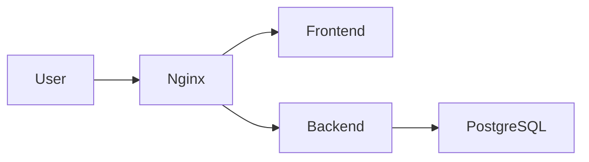

# <Project Name>

<One sentence: what it does and for whom.>


| | |
|---|---|
|  |  |

## Architecture


## Features
- <Feature>: <one-line description>          (max 8 bullets)

## Quick Start
```bash
git clone <repo> && cd <project>
docker compose up -d
```
Equivalents: `make up`, `podman compose up -d` (rootless).
Open https://localhost:8443 (self-signed certificate) — first admin password: `docker compose exec backend python -m app.cli admin-password`.

## Deployment
| Target | Commands |
|---|---|
| Docker | ... |
| Podman (rootless) | ... |
(each ≤ 5 commands, production settings: TLS certificate, secrets provider, backups)

## Configuration
| Variable | Default | Description |
|---|---|---|

## API
| Method | Path | Auth | Description |
|---|---|---|---|
Full spec: `/api/v1/openapi.json` (admin only in production).

## Security
- <measure>
### Security & Compliance Scans
| Tool | Version | Target | Result | Date |
|---|---|---|---|---|
<details><summary>Nginx configuration</summary> ... </details>

## Development
| Command | Purpose |
|---|---|
| `make dev` | ... |

## Project Structure
<tree, depth 2 max>

## License
<one line>
